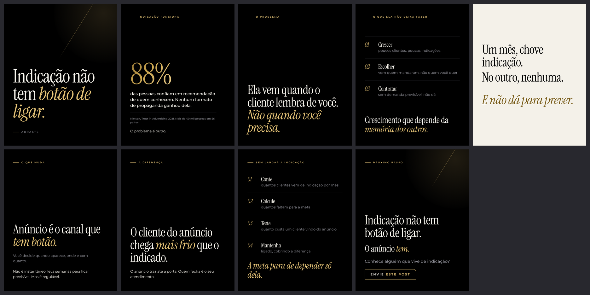

# Carrossel 06 · Indicação não tem botão de ligar

- Série 2 · nível de consciência: Inconsciente para consciente do problema · ação: Enviar
- Nota do crítico independente (versão v6): 7.0. Versão abaixo já é a 7ª reanálise.
- Status: Canvas pronto em `canvas/` (arquivos locais), NÃO publicado: a criação de artifact foi bloqueada pela permissão da sessão. Para publicar, ver `../README.md`.

## Roteiro final
*itálico* = a única ênfase dourada do slide. Fonte da verdade: `roteiro.json`.

1. **Capa** (capa) · "Indicação não tem *botão de ligar.*" · Arraste
2. **Indicação funciona** · rótulo INDICAÇÃO FUNCIONA · numeral "88%" · lead "das pessoas confiam em recomendação de quem conhecem. Nenhum formato de propaganda ganhou dela." · nota "Nielsen, Trust in Advertising 2021. Mais de 40 mil pessoas em 56 países." · corpo "O problema é outro."
3. **O problema** · rótulo O PROBLEMA · manchete "Ela vem quando o cliente lembra de você. *Não quando você precisa.*"
4. **O que ela não deixa fazer** · rótulo O QUE ELA NÃO DEIXA FAZER · 01 Crescer: poucos clientes, poucas indicações · 02 Escolher: vem quem mandaram, não quem você quer · 03 Contratar: sem demanda previsível, não dá · fecho "Crescimento que depende da *memória dos outros.*"
5. **Pausa** (pausa, marfim) · "Um mês, chove indicação." / "No outro, nenhuma." / "*E não dá para prever.*"
6. **O que muda** · rótulo O QUE MUDA · manchete "Anúncio é o canal que *tem botão.*" · corpo-suave "Você decide quando aparece, onde e com quanto." · corpo "Não é instantâneo: leva semanas para ficar previsível. Mas é regulável."
7. **A diferença** · rótulo A DIFERENÇA · manchete "O cliente do anúncio chega *mais frio* que o indicado." · corpo "O anúncio traz até a porta. Quem fecha é o seu atendimento."
8. **Sem largar a indicação** · rótulo SEM LARGAR A INDICAÇÃO · 01 Conte: quantos clientes vêm de indicação por mês · 02 Calcule: quantos faltam para a meta · 03 Teste: quanto custa um cliente vindo do anúncio · 04 Mantenha: ligado, cobrindo a diferença · fecho "*A meta para de depender só dela.*"
9. **CTA** · rótulo PRÓXIMO PASSO · manchete "Indicação não tem botão de ligar." · titulo "O anúncio *tem.*" · lead "Conhece alguém que vive de indicação?" · chave ENVIE ESTE POST

## Legenda (primeira pessoa do Arthur)

> Cliente indicado chega pronto para comprar. Só não chega quando você chama.
>
> Não sou eu que digo que indicação funciona. Na pesquisa Trust in Advertising da Nielsen, de 2021, com mais de 40 mil pessoas em 56 países, 88% disseram confiar em recomendação de quem conhecem. Nenhum formato de propaganda ganhou dela.
>
> O problema é que ela chega quando o cliente lembra de você, e não quando o seu caixa precisa.
>
> Tráfego pago não substitui a indicação. E vou ser honesto: o cliente que vem do anúncio chega mais frio que o indicado. O anúncio traz até a porta, quem fecha é o atendimento. Mas é o canal que você regula: quando aparece, onde e com quanto. Não é instantâneo, leva semanas para ficar previsível.
>
> Conhece alguém que vive de indicação? Envie este post para ele.

Histórico do processo (rascunho, reanálises, pesquisa, crítica, filtro): `../processo/serie-2/`.
