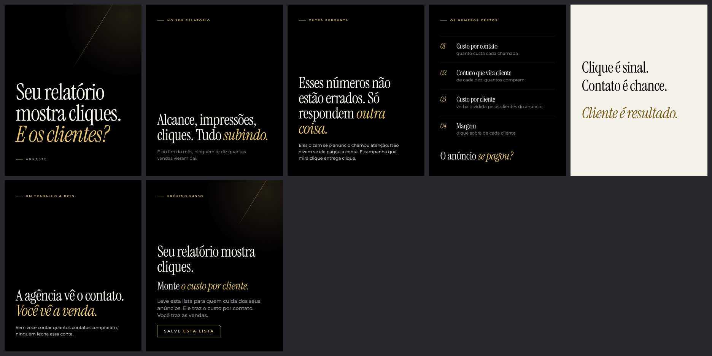

# Carrossel 08 · Seu relatório mostra cliques. E os clientes?

**Canvas publicado:** https://claude.ai/artifact/R2VopuvsdWj2aZrMZBu4rm

- Série 2 · nível de consciência: Consciente do problema · ação: Salvar
- Nota do crítico independente (versão v6): 7.4. Versão abaixo já é a 7ª reanálise.
- Status: Canvas pronto em `canvas/` (arquivos locais), NÃO publicado: a criação de artifact foi bloqueada pela permissão da sessão. Para publicar, ver `../README.md`.

## Roteiro final
*itálico* = a única ênfase dourada do slide. Fonte da verdade: `roteiro.json`.

1. **Capa** (capa) · "Seu relatório mostra cliques. *E os clientes?*" · Arraste
2. **No seu relatório** · rótulo NO SEU RELATÓRIO · manchete "Alcance, impressões, cliques. Tudo *subindo.*" · corpo-suave "E no fim do mês, ninguém te diz quantas vendas vieram daí."
3. **Outra pergunta** · rótulo OUTRA PERGUNTA · manchete "Esses números não estão errados. Só respondem *outra coisa.*" · corpo "Eles dizem se o anúncio chamou atenção. Não dizem se ele pagou a conta. E campanha que mira clique entrega clique."
4. **Os números certos** · rótulo OS NÚMEROS CERTOS · 01 Custo por contato: quanto custa cada chamada · 02 Contato que vira cliente: de cada dez, quantos compram · 03 Custo por cliente: verba dividida pelos clientes do anúncio · 04 Margem: o que sobra de cada cliente · fecho "O anúncio *se pagou?*"
5. **Pausa** (pausa, marfim) · "Clique é sinal." / "Contato é chance." / "*Cliente é resultado.*"
6. **Um trabalho a dois** · rótulo UM TRABALHO A DOIS · manchete "A agência vê o contato. *Você vê a venda.*" · corpo "Sem você contar quantos contatos compraram, ninguém fecha essa conta."
7. **CTA** · rótulo PRÓXIMO PASSO · manchete "Seu relatório mostra cliques." · titulo "Monte *o custo por cliente.*" · lead "Leve esta lista para quem cuida dos seus anúncios. Ele traz o custo por contato. Você traz as vendas." · chave SALVE ESTA LISTA

## Legenda (primeira pessoa do Arthur)

> Seu relatório de tráfego pago mostra cliques. Mas quantos clientes vieram daí?
>
> Alcance, impressões e cliques não estão errados. Eles dizem se o anúncio chamou atenção. Não dizem se ele pagou a conta.
>
> Os números que eu olho são quatro: custo por contato, quantos contatos viram cliente, custo por cliente e a margem de cada um.
>
> E tem uma parte que só você vê: a venda. Quem cuida do anúncio traz o custo por contato. Você traz quantos compraram. Juntos, sai o custo por cliente.
>
> Qual desses quatro você sabe hoje de cabeça?
>
> Salve este post e leve a lista para a próxima conversa com quem cuida dos seus anúncios.

Histórico do processo (rascunho, reanálises, pesquisa, crítica, filtro): `../processo/serie-2/`.
