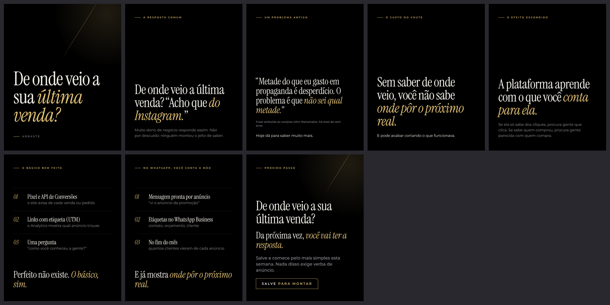

# Carrossel 09 · De onde veio a sua última venda?

- Série 2 · nível de consciência: Consciente do problema para consciente da solução · ação: Salvar
- Nota do crítico independente (versão v6): 7.3. Versão abaixo já é a 7ª reanálise.
- Status: Canvas pronto em `canvas/` (arquivos locais), NÃO publicado: a criação de artifact foi bloqueada pela permissão da sessão. Para publicar, ver `../README.md`.

## Roteiro final
*itálico* = a única ênfase dourada do slide. Fonte da verdade: `roteiro.json`.

1. **Capa** (capa) · "De onde veio a sua *última venda?*" · Arraste
2. **A resposta comum** · rótulo A RESPOSTA COMUM · manchete "De onde veio a última venda? “Acho que *do Instagram.*”" · corpo-suave "Muito dono de negócio responde assim. Não por descuido: ninguém montou o jeito de saber."
3. **Um problema antigo** · rótulo UM PROBLEMA ANTIGO · titulo "“Metade do que eu gasto em propaganda é desperdício. O problema é que *não sei qual metade.*”" · nota "Frase atribuída ao varejista John Wanamaker, há mais de cem anos." · corpo "Hoje dá para saber muito mais."
4. **O custo do chute** · rótulo O CUSTO DO CHUTE · manchete "Sem saber de onde veio, você não sabe *onde pôr o próximo real.*" · corpo "E pode acabar cortando o que funcionava."
5. **O efeito escondido** · rótulo O EFEITO ESCONDIDO · manchete "A plataforma aprende com o que você *conta para ela.*" · corpo-suave "Se ela só sabe dos cliques, procura gente que clica. Se sabe quem comprou, procura gente parecida com quem compra."
6. **O básico bem feito** · rótulo O BÁSICO BEM FEITO · 01 Pixel e API de Conversões: o site avisa de cada venda ou pedido · 02 Links com etiqueta (UTM): o Analytics mostra qual anúncio trouxe · 03 Uma pergunta: “como você conheceu a gente?” · fecho "Perfeito não existe. *O básico, sim.*"
7. **No WhatsApp, à mão** · rótulo NO WHATSAPP, VOCÊ CONTA À MÃO · 01 Mensagem pronta por anúncio: “vi o anúncio da promoção” · 02 Etiquetas no WhatsApp Business: contato, orçamento, cliente · 03 No fim do mês: quantos clientes vieram de cada anúncio · fecho "E já mostra *onde pôr o próximo real.*"
8. **CTA** · rótulo PRÓXIMO PASSO · manchete "De onde veio a sua última venda?" · titulo "Da próxima vez, *você vai ter a resposta.*" · lead "Salve e comece pelo mais simples esta semana. Nada disso exige verba de anúncio." · chave SALVE PARA MONTAR

## Legenda (primeira pessoa do Arthur)

> De onde veio a sua última venda? Se a resposta começou com “acho que”, você não está sozinho.
>
> Tem uma frase atribuída ao varejista John Wanamaker, de mais de cem anos atrás: metade do que ele gastava em propaganda era desperdício, o problema é que ele não sabia qual metade.
>
> Hoje dá para saber muito mais. O básico: Pixel e API de Conversões no site, um link com etiqueta (UTM) para cada anúncio, um número ou página por canal e uma pergunta simples para o cliente: como você conheceu a gente?
>
> No WhatsApp, a conta é à mão: uma mensagem pronta diferente para cada anúncio e etiquetas no WhatsApp Business. No fim do mês, você vê quantos clientes vieram de cada um.
>
> Nada disso exige verba de anúncio. Algumas partes pedem ajuda técnica, outras você faz hoje.
>
> Salve este post e comece pelo mais simples.

Histórico do processo (rascunho, reanálises, pesquisa, crítica, filtro): `../processo/serie-2/`.
