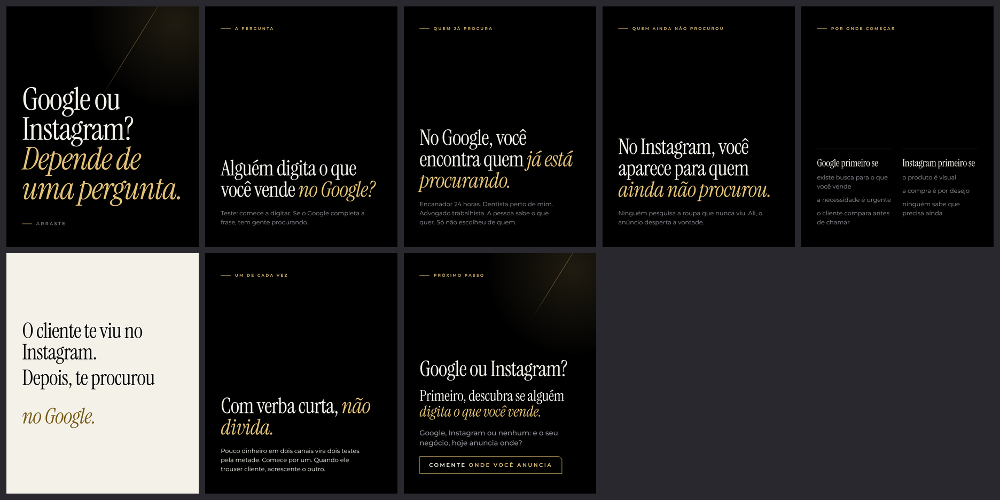

# Carrossel 11 · Google ou Instagram?

- Série 2 · nível de consciência: Consciente da solução · ação: Comentar onde anuncia
- Nota do crítico independente (versão v6): 6.6. Versão abaixo já é a 7ª reanálise.
- Status: Canvas pronto em `canvas/` (arquivos locais), NÃO publicado: a criação de artifact foi bloqueada pela permissão da sessão. Para publicar, ver `../README.md`.

## Roteiro final
*itálico* = a única ênfase dourada do slide. Fonte da verdade: `roteiro.json`.

1. **Capa** (capa) · "Google ou Instagram? *Depende de uma pergunta.*" · Arraste
2. **A pergunta** · rótulo A PERGUNTA · manchete "Alguém digita o que você vende *no Google?*" · corpo-suave "Teste: comece a digitar. Se o Google completa a frase, tem gente procurando."
3. **Quem já procura** · rótulo QUEM JÁ PROCURA · manchete "No Google, você encontra quem *já está procurando.*" · corpo-suave "Encanador 24 horas. Dentista perto de mim. Advogado trabalhista. A pessoa sabe o que quer. Só não escolheu de quem."
4. **Quem ainda não procurou** · rótulo QUEM AINDA NÃO PROCUROU · manchete "No Instagram, você aparece para quem *ainda não procurou.*" · corpo-suave "Ninguém pesquisa a roupa que nunca viu. Ali, o anúncio desperta a vontade."
5. **Por onde começar** · rótulo POR ONDE COMEÇAR · Google primeiro se: existe busca para o que você vende; a necessidade é urgente; o cliente compara antes de chamar | Instagram primeiro se: o produto é visual; a compra é por desejo; ninguém sabe que precisa ainda
6. **Pausa** (pausa, marfim) · "O cliente te viu no Instagram." / "Depois, te procurou" / "*no Google.*"
7. **Um de cada vez** · rótulo UM DE CADA VEZ · manchete "Com verba curta, *não divida.*" · corpo "Pouco dinheiro em dois canais vira dois testes pela metade. Comece por um. Quando ele trouxer cliente, acrescente o outro."
8. **CTA** · rótulo PRÓXIMO PASSO · manchete "Google ou Instagram?" · titulo "Primeiro, descubra se alguém *digita o que você vende.*" · lead "Google, Instagram ou nenhum: e o seu negócio, hoje anuncia onde?" · chave COMENTE ONDE VOCÊ ANUNCIA

## Legenda (primeira pessoa do Arthur)

> Google ou Instagram? Depende de uma pergunta: alguém digita o que você vende no Google?
>
> Um teste rápido: comece a digitar. Se o Google completa a frase, tem gente procurando.
>
> Se tem, o Google te coloca na frente de quem já está procurando. Encanador 24 horas, dentista perto de mim, advogado trabalhista.
>
> Se ninguém procura o que você vende antes de ver, o Instagram é onde você aparece para quem ainda não sabe que quer. E quem te viu no Instagram pode te procurar depois no Google.
>
> Com verba curta, não divida. Comece por um e acrescente o outro quando ele trouxer cliente. E lembre: nos dois, o anúncio só traz até a porta.
>
> Se você ainda não me segue, segue: a série continua.
>
> Agora comenta aqui: Google, Instagram ou nenhum?

Histórico do processo (rascunho, reanálises, pesquisa, crítica, filtro): `../processo/serie-2/`.
