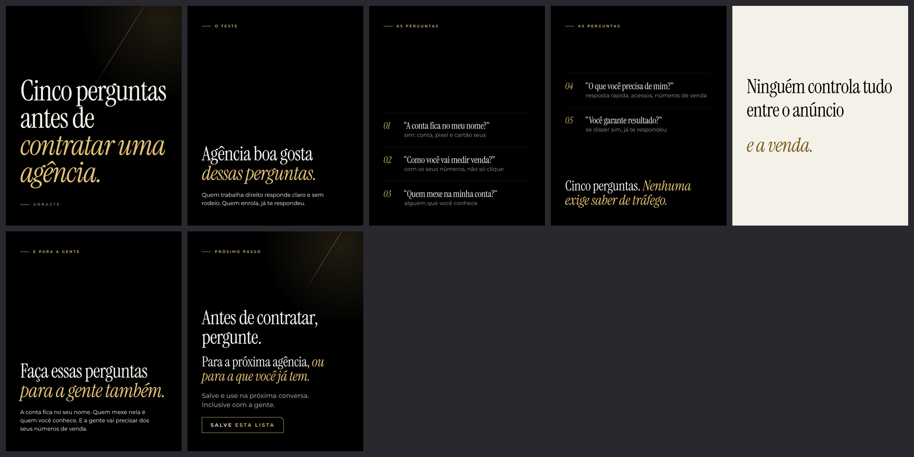

# Carrossel 14 · Cinco perguntas antes de contratar uma agência

**Canvas publicado:** https://claude.ai/artifact/EAJRC9spcyPXFV2W1MuwLV

- Série 2 · nível de consciência: Consciente do produto · ação: Salvar
- Nota do crítico independente (versão v6): 7.0. Versão abaixo já é a 7ª reanálise.
- Status: Canvas pronto em `canvas/` (arquivos locais), NÃO publicado: a criação de artifact foi bloqueada pela permissão da sessão. Para publicar, ver `../README.md`.

## Roteiro final
*itálico* = a única ênfase dourada do slide. Fonte da verdade: `roteiro.json`.

1. **Capa** (capa) · "Cinco perguntas antes de *contratar uma agência.*" · Arraste
2. **O teste** · rótulo O TESTE · manchete "Agência boa gosta *dessas perguntas.*" · corpo "Quem trabalha direito responde claro e sem rodeio. Quem enrola, já te respondeu."
3. **As perguntas** · rótulo AS PERGUNTAS · 01 “A conta fica no meu nome?”: sim: conta, pixel e cartão seus · 02 “Como você vai medir venda?”: com os seus números, não só clique · 03 “Quem mexe na minha conta?”: alguém que você conhece
4. **As perguntas, continuação** · rótulo AS PERGUNTAS · 04 “O que você precisa de mim?”: resposta rápida, acessos, números de venda · 05 “Você garante resultado?”: se disser sim, já te respondeu · fecho "Cinco perguntas. *Nenhuma exige saber de tráfego.*"
5. **Pausa** (pausa, marfim) · "Ninguém controla tudo" / "entre o anúncio" / "*e a venda.*"
6. **E para a gente** · rótulo E PARA A GENTE · manchete "Faça essas perguntas *para a gente também.*" · corpo "A conta fica no seu nome. Quem mexe nela é quem você conhece. E a gente vai precisar dos seus números de venda."
7. **CTA** · rótulo PRÓXIMO PASSO · manchete "Antes de contratar, pergunte." · titulo "Para a próxima agência, *ou para a que você já tem.*" · lead "Salve e use na próxima conversa. Inclusive com a gente." · chave SALVE ESTA LISTA

## Legenda (primeira pessoa do Arthur)

> Antes de contratar alguém para cuidar do seu tráfego pago, faça estas cinco perguntas. Agência boa gosta delas.
>
> 1. A conta de anúncio fica no meu nome? (A resposta boa: conta, pixel e cartão no seu portfólio da Meta.)
> 2. Como você vai medir venda, e não só clique?
> 3. Quem mexe na minha conta?
> 4. O que você precisa de mim?
> 5. Você garante resultado? (Se disser sim, já te respondeu.)
>
> Ninguém controla tudo o que acontece entre o anúncio e a venda. Por isso garantia não é a pergunta certa. Processo é.
>
> Serve também para a agência que você já tem. E para a minha.
>
> Salve para usar na próxima conversa.

## Confirmar antes de postar
- Confirmar: conta de anúncio no nome do cliente; quem mexe na conta é alguém que ele conhece.

Histórico do processo (rascunho, reanálises, pesquisa, crítica, filtro): `../processo/serie-2/`.
