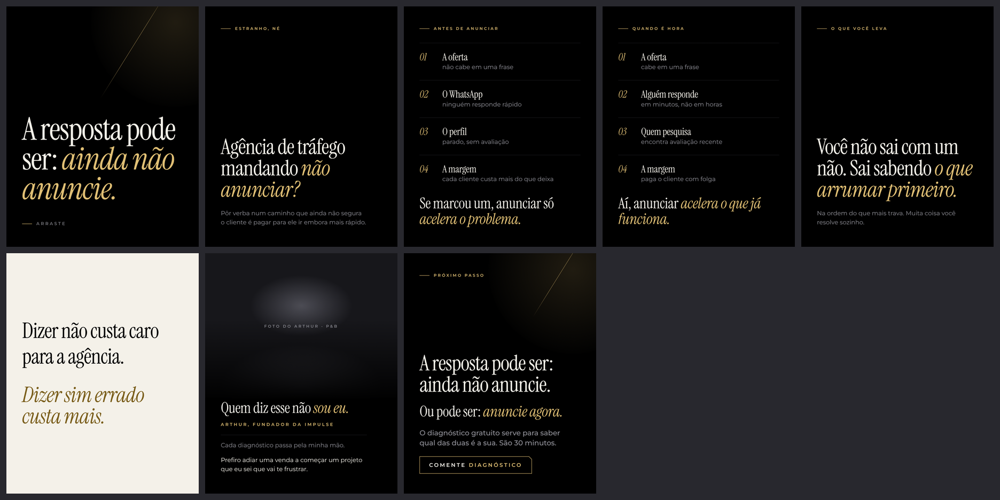

# Carrossel 15 · A resposta pode ser: ainda não anuncie

**Canvas publicado:** https://claude.ai/artifact/MSRaVvuxDK6imR8kWTfzf9

- Série 2 · nível de consciência: Totalmente consciente · ação: Comentar Diagnóstico
- Nota do crítico independente (versão v6): 6.9. Versão abaixo já é a 7ª reanálise.
- Status: Canvas pronto em `canvas/` (arquivos locais), NÃO publicado: a criação de artifact foi bloqueada pela permissão da sessão. Para publicar, ver `../README.md`.

## Roteiro final
*itálico* = a única ênfase dourada do slide. Fonte da verdade: `roteiro.json`.

1. **Capa** (capa) · "A resposta pode ser: *ainda não anuncie.*" · Arraste
2. **Estranho, né** · rótulo ESTRANHO, NÉ · manchete "Agência de tráfego mandando *não anunciar?*" · corpo-suave "Pôr verba num caminho que ainda não segura o cliente é pagar para ele ir embora mais rápido."
3. **Antes de anunciar** · rótulo ANTES DE ANUNCIAR · 01 A oferta: não cabe em uma frase · 02 O WhatsApp: ninguém responde rápido · 03 O perfil: parado, sem avaliação · 04 A margem: cada cliente custa mais do que deixa · fecho "Se marcou um, anunciar só *acelera o problema.*"
4. **Quando é hora** · rótulo QUANDO É HORA · 01 A oferta: cabe em uma frase · 02 Alguém responde: em minutos, não em horas · 03 Quem pesquisa: encontra avaliação recente · 04 A margem: paga o cliente com folga · fecho "Aí, anunciar *acelera o que já funciona.*"
5. **O que você leva** · rótulo O QUE VOCÊ LEVA · manchete "Você não sai com um não. Sai sabendo *o que arrumar primeiro.*" · corpo-suave "Na ordem do que mais trava. Muita coisa você resolve sozinho."
6. **Pausa** (pausa, marfim) · "Dizer não custa caro" / "para a agência." / "*Dizer sim errado custa mais.*"
7. **Arthur** · Foto do Arthur · P&B · titulo "Quem diz esse não *sou eu.*" · ARTHUR, FUNDADOR DA IMPULSE · suave "Cada diagnóstico passa pela minha mão." · "Prefiro adiar uma venda a começar um projeto que eu sei que vai te frustrar."
8. **CTA** · rótulo PRÓXIMO PASSO · manchete "A resposta pode ser: ainda não anuncie." · titulo "Ou pode ser: *anuncie agora.*" · lead "O diagnóstico gratuito serve para saber qual das duas é a sua. São 30 minutos." · chave COMENTE DIAGNÓSTICO

## Legenda (primeira pessoa do Arthur)

> A resposta do diagnóstico pode ser: ainda não anuncie. Parece estranho vindo de quem vive de tráfego pago.
>
> Mas pôr verba num caminho que ainda não segura o cliente é pagar para ele ir embora mais rápido. Isso é ruim para você e é ruim para mim.
>
> Se a oferta não cabe em uma frase, se ninguém responde rápido no WhatsApp, se o perfil está parado e sem avaliação, ou se cada cliente custa mais do que deixa, anunciar só acelera o problema.
>
> Quando é assim, você não sai com um não. Sai sabendo o que arrumar primeiro. Muita coisa você resolve sozinho.
>
> E quando a oferta cabe em uma frase, alguém responde em minutos, quem pesquisa encontra avaliação recente e a margem paga o cliente com folga, a resposta é a outra: anuncie agora.
>
> Se você ainda não me segue, segue antes: direct de quem não segue cai em solicitações.
>
> Se quiser saber qual das duas é a sua, comenta DIAGNÓSTICO.

## Confirmar antes de postar
- Confirmar 'cada diagnóstico passa pela minha mão'.
- Foto do Arthur P&B no slide 7.

Histórico do processo (rascunho, reanálises, pesquisa, crítica, filtro): `../processo/serie-2/`.
